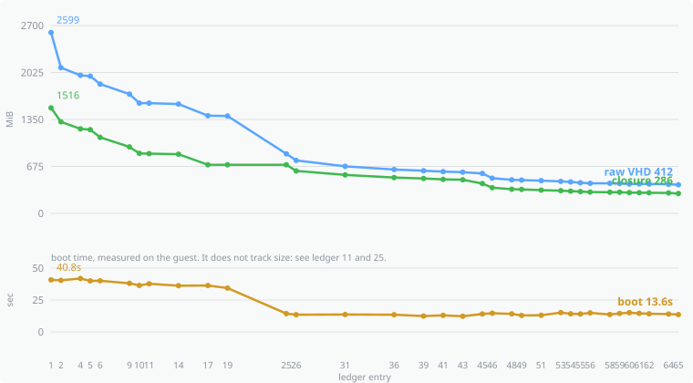

# smol NixOS base image, nivis to EC2

How small can our NixOS base image for AWS EC2 get while it still boots on
EC2, deploys through [nivis](https://github.com/nivis-project/nivis), and stays
fully functional over SSH?

Every size-reduction strategy becomes a NixOS module option under `smol.*`,
with a measured saving, its trade-offs and its source. The repo documents
itself: the ledger, `REPORT.md` and the generated option docs together say
what was tried, what worked, what failed and why.

## Where to look

| file | what it holds |
| ---------------- | ------------------------------------------------ |
| `BRIEFING.md`    | the brief, and the source of truth |
| `STATE.md`       | where the lab is right now |
| `CLAUDE.md`      | how the work is run |
| `docs/TESTING.md`| the verification contract and the two gates |
| `ledger.jsonl`   | one append-only line per experiment |
| `BACKLOG.md`     | hypotheses not yet tried |
| `GOTCHAS.md`     | every non-obvious failure and its cause |
| `FLOOR.md`       | what is left and why it cannot go |
| `docs/options.md`| generated from the `smol.*` options |

## Getting started

```sh
nix develop          # just, jq, awscli2, shellcheck, qemu, nivis
just                 # the recipe list
just check           # nix flake check
just gate1 accepted  # boot it in QEMU and run the contract over SSH
```

EC2 deployment needs the one-time AWS setup in `docs/SETUP-AWS.md`.

## Prior art

- natkr, [I can haz smoller NixOS ISOs?](https://natkr.com/2026-06-19-nixos-but-smol/)
- siraben, [Smallest bootable NixOS ISO](https://gist.github.com/siraben/a8fce9912891d85e1ec3cf74081ba4f6)

Both targeted an ISO with a local root shell. This lab needs networking, DHCP,
sshd, EC2 metadata and the Nitro drivers, so the floor here is higher. Finding
out how much higher is the point.

<!-- STATS:BEGIN -->
## Progress

| | baseline | now | off |
| --- | --- | --- | --- |
| **closure** | 1516 MiB | **334 MiB** | 78.0% |
| **raw VHD** | 2599 MiB | **470 MiB** | 81.9% |
| **boot time** | 40.8s | **13.1s** | 67.8% |

The raw VHD is what gets uploaded, imported as an EBS snapshot and stored as
an AMI. It is the number that costs money, and it is not the closure.



Boot time is on its own panel rather than a second axis on the size plot,
because it does not track size. Experiment 10 looked like a downward trend
and experiment 11 broke it; experiment 25 moved boot time by 22 seconds
without changing the closure by a single byte. Why it moved is
[backlog item `e15`](BACKLOG.md) and not yet answered.

### Backlog

| state | n | |
| --- | --- | --- |
| accepted | 20 | `████████████████············` |
| rejected | 3 | `██··························` |
| needs-upstream | 0 | `····························` |
| todo | 13 | `██████████··················` |

### Stop criteria (BRIEFING section 9)

- [ ] the last 8 accepted experiments each saved under 1% or under 2 MiB (1 of 8)
- [ ] every backlog item accepted, rejected or needs-upstream (13 still todo)
- [x] `FLOOR.md` justifies every remaining path over 1 MiB

### Last six ledger entries

| id | strategy | closure MiB | image MiB | decision |
| --- | --- | --- | --- | --- |
| 46 | `no-perl` | +58.7 | +68.0 | **accepted** |
| 47 | `no-duplicate-systemd` | n/a | n/a | rejected: build failed |
| 48 | `no-duplicate-systemd` | +22.4 | +24.0 | **accepted** |
| 49 | `no-editor` | +2.5 | +4.0 | **accepted** |
| 50 | `no-user-data-decompression` | +11.4 | +12.0 | rejected: gate 2 failed |
| 51 | `no-user-data-decompression` | +11.4 | +8.0 | **accepted** |

Full history in [`ledger.jsonl`](ledger.jsonl), one note per experiment in
[`experiments/`](experiments/).
<!-- STATS:END -->
